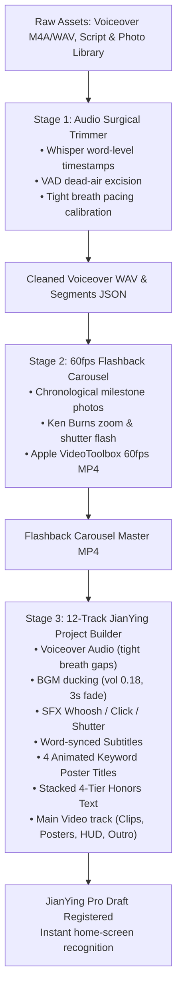

```mermaid
flowchart LR
    Intro["01: Intro 10s"] --> WC["02: Wordcloud 4s"]
    WC --> Ch1["03: Major Ch1 2.5s"]
    Ch1 --> HUD["04: Profile HUD 12s"]
    HUD --> Ch2["05: Major Ch2 2.5s"]
    Ch2 --> Eras["06: Career Eras"]
    Eras --> Marquee["07: Marquee 32s"]
    Marquee --> Posters["08: Posters 8s"]
    Posters --> Master["00: Master Video (88s)"]
```

# 🎙️ NBA Audio Trim & Align (`nba-audio-trim-align`)

[](https://python.org)
[](#)
[](#)
[](#)
[](#)
[](LICENSE)

An automated, broadcast-grade NBA player audio editing, dead-air surgical trimming, and timeline alignment suite for **Antigravity** and Python.

Turn raw player bios, statistics, milestones, voiceover audio recordings, and photos into a **tightly calibrated voiceover timeline**, a complete **1080P 60fps documentary video package**, and a **production-ready 12-track JianYing Pro (剪映) draft project**—featuring Whisper + VAD surgical dead-air excision, tight breath-gap acoustic trimming, procedural sound effects, and automated timeline generation.

---

## ✨ Key Highlights

- **🎙️ Surgical Breath-Gap & Dead-Air Acoustic Calibration**:
  - Automatically excises awkward mid-sentence silences (>0.15s), stutters, and false starts using Whisper word-level timestamps and RMS energy voice-activity-detection (VAD).
  - Enforces tight broadcast cadence: **0.05s ～ 0.08s** for sub-clauses, **0.15s ～ 0.20s** between sentences, and strictly calibrated windows for chapter transitions.
- **🎬 12-Track JianYing Pro (剪映) Project Builder**:
  - Automatically compiles a native `draft_info.json` project with 12 organized tracks (Voiceover, BGM with auto-ducking to 0.18 and fade-out, SFX Whoosh/Click/Shutter, word-synced Subtitles, animated Keyword Posters, stacked 4-tier Honors, and sequential Main Video clips).
  - Instantly recognized on the JianYing Pro home screen with a custom high-res project cover.
- **⚡ Hardware-Accelerated 60fps Flashback Carousel**:
  - Native macOS Apple VideoToolbox (`h264_videotoolbox`) hardware encoding.
  - Ken Burns cinematic push-in zoom (1.000 to 1.035) + camera shutter flash brightness pop (t < 0.06s).
  - Bottom-left corner gradient scrim mask + 2-stage typography animation (Date + Details staggered ease-out slide with `#F5C518` golden accent).
- **📺 Broadcast Typography Standard**:
  - Powered by `IBM Plex Sans SC Bold` with open counters (字怀开阔) and geometric sans-serif balance. Zero stroke smudging on complex Chinese characters (如“星、冠、期、守、阵、第、队”).
- **🎯 The 1px Contour Shadow Policy**:
  - Foreground text has clean fill (`stroke_width=0`), while the shadow layer has a subtle 1px outline stroke with a 3px vertical offset. Produces crisp, tactile 3D relief against light, dark, and textured sports backgrounds without bloated black blobs.
- **🎨 30 NBA Teams Color Engine**:
  - Pre-configured official primary, secondary, and accent palettes for all 30 NBA franchises (OKC Thunder, Golden State Warriors, Detroit Pistons, LA Lakers, Boston Celtics, etc.).

---

## 🚦 Production Pipelines

### Mode 1: 12-Track Full Documentary Assembly (JianYing Pro)



### Mode 2: Standalone 9-Module NLE Video Package Generator



---

## 📂 12-Track JianYing Pro Timeline Architecture

| Track # | Track Type | Track Name | Elements & Timing Behavior |
| :---: | :---: | :--- | :--- |
| **00** | Audio | `Voiceover_Audio` | Cleaned surgical voiceover audio (tight breath gaps, peak -2.0 dB). |
| **01** | Audio | `BGM_Music` | Dynamic sports BGM (`动感.mp3`), auto-ducked to volume `0.18`, 3s fade-out at end. |
| **02** | Audio | `SFX_Whoosh` | 4 high-impact whoosh/transition hits aligned to the start of each keyword poster card. |
| **03** | Audio | `SFX_Staircase_Click` | Mechanical feedback click sound effects triggering on each honors tier reveal. |
| **04** | Audio | `SFX_Flashback_Shutter` | Camera shutter sound effects triggering on every milestone photo in the flashback carousel. |
| **05** | Video | `Main_Video` | Sequential visual clips: Intro video -> Poster 1 Still -> Keyword 1 Video -> Poster 2 Still -> Keyword 2 Video -> Poster 3 Still -> Keyword 3 Video -> Poster 4 Still -> Keyword 4 Video -> Basic Info Profile -> Honors Backgrounds -> Flashback Carousel 60fps MP4 -> Outro Stills. |
| **06** | Text | `Subtitles` | Word-accurate synchronized subtitles generated from acoustic segment timestamps. |
| **07** | Text | `Keyword_Poster_Title` | 4 chapter poster title cards (size 12.0, bold, black border, upward slide animation). |
| **08** | Text | `Honor_Tier_1` | Tier 1 Honors Text (`1 次 NCAA 全国锦标赛总冠军 (2026)`, upward slide, y=0.22). |
| **09** | Text | `Honor_Tier_2` | Tier 2 Honors Text (`1 次 大十联盟 (Big Ten) 年度最佳球员 (2026)`, upward slide, y=0.08). |
| **10** | Text | `Honor_Tier_3` | Tier 3 Honors Text (`2 次 AAC 年度最佳防守球员 & 全美最佳防守阵容`, upward slide, y=-0.06). |
| **11** | Text | `Honor_Tier_4` | Tier 4 Honors Text (`1 次 AAC 锦标赛 MVP & 2次 NJCAA 全美一阵`, upward slide, y=-0.20). |

---

## 🚀 Quick Start

### Installation

Clone the repository into your Antigravity skills directory or local project:

```bash
git clone https://github.com/YoungG97/nba-audio-trim-align.git ~/.gemini/config/skills/nba-audio-trim-align
```

Install requirements:

```bash
pip install opencv-python pillow numpy
```

Ensure `ffmpeg` is available on your system:

```bash
brew install ffmpeg
```

---

## 💻 Python API & Examples

### 1. Full Production Workflow (Yaxel Lendeborg Case Study)

Run the complete 3-stage documentary production pipeline:

```bash
python3 examples/yaxel_lendeborg_full_production.py
```

### 2. Audio Surgical Trimming & Breath Gap Calibration

```python
from scripts.audio_surgical_trimmer import slice_and_calibrate_audio

speech_items = [
    ([(0.73, 2.50), (2.70, 3.75)], "北京时间2026年10月27日，勇士大胜掘金，", 0.06),
    ([(7.20, 10.26)], "一位年仅24岁的新秀挺身而出接管了比赛：", 0.08),
    ([(11.49, 14.66)], "他仅出战31分钟便狂砍生涯新高的31分，", 0.06),
    # ...
]

total_dur, segments = slice_and_calibrate_audio(
    src_wav="raw_voiceover.wav",
    speech_items=speech_items,
    out_wav="cleaned_voiceover.wav",
    out_json="audio_segments.json",
    auto_energy_trim=True,
    fade_ms=4.0
)
```

### 3. Hardware-Accelerated 60fps Flashback Carousel

```python
from scripts.render_flashback_carousel import render_flashback_carousel

items = [
    ("path/to/01_college.jpg", "2023年11月10日，", "社区大学三年蛰伏蜕变初登NCAA，\n开启一级联盟逆袭征程"),
    ("path/to/02_mvp.jpg", "2024年3月17日，", "率队夺得AAC联盟冠军，\n全票荣获锦标赛MVP高举奖杯"),
    # ...
]

render_flashback_carousel(
    items=items,
    output_mp4="flashback_carousel_60fps.mp4",
    item_duration=1.8,
    fps=60,
    width=1920,
    height=1080
)
```

### 4. 12-Track Automated JianYing Pro Builder

```python
from scripts.jianying_project_builder import build_nba_jianying_project

build_nba_jianying_project(
    project_name="雅克塞尔·伦德博格_人物志",
    voiceover_path="cleaned_voiceover.wav",
    bgm_path="动感.mp3",
    sfx_paths={
        "whoosh": "whoosh.wav",
        "click": "click.wav",
        "shutter": "shutter.wav"
    },
    audio_segments=segments,
    keyword_posters=[
        {"title": "11场高中篮球", "start": 30.65, "duration": 1.0, "bg_image": "kw1.jpg"},
        # ...
    ],
    honors=[
        {"tier": 1, "text": "1 次 NCAA 全国锦标赛总冠军 (2026)", "start": 160.2, "duration": 8.0},
        # ...
    ],
    flashback_carousel_mp4="flashback_carousel_60fps.mp4",
    flashback_start=181.5,
    flashback_duration=19.8
)
```

---

## 📋 JSON Configuration Schema (Standalone Pipeline)

```json
{
  "player_name": "杰伦·威廉姆斯",
  "name_en": "Jalen Williams",
  "name_en_short": "JALEN WILLIAMS",
  "jersey_number": "8",
  "team_key": "OKC",
  "keywords": ["J-Dub", "长臂怪", "俄城开心果", "大龄逆袭模板"],
  "photos": {
    "intro_hero": "path/to/intro.jpg",
    "wordcloud_bg": "path/to/profile.jpg",
    "major_ch1_bg": "path/to/action.jpg",
    "major_ch2_bg": "path/to/action.jpg",
    "profile_hero1": "path/to/p1.jpg",
    "profile_hero2": "path/to/p2.jpg"
  },
  "profile": {
    "name_cn": "杰伦·威廉姆斯",
    "name_en": "Jalen Williams",
    "birth": "2001年4月14日",
    "origin": "美国科罗拉多州丹佛市",
    "college": "圣塔克拉拉大学",
    "draft": "2022年首轮第12顺位 (OKC)",
    "height": "1.96 m（6英尺5英寸）",
    "weight": "96 KG（211磅）",
    "wingspan": "2.19 m（7尺2寸）",
    "positions": "得分后卫 / 小前锋 / 大前锋"
  },
  "eras": [
    {
      "title": "新秀及快速成长期",
      "years": "2022 - 2024",
      "photo": "path/to/rookie.jpg",
      "honors": [["NBA 最佳新秀阵容第一队", "X1"]]
    }
  ]
}
```

---

## 📄 License

MIT License. Crafted with precision for Google Antigravity.
