# 🏀 NBA Player Video Maker

[](https://python.org)
[](#)
[](#)
[](#)
[](LICENSE)

An automated, broadcast-grade NBA player documentary and sports video production suite for **Antigravity** and Python. 

Turn raw player bios, statistics, milestones, and photos into a complete **1080P 60fps** documentary video package—featuring ESPN/TNT-style broadcast graphics, procedural sound effects, and automated timeline delivery folders ready for **Premiere Pro**, **Final Cut Pro**, and **剪映 (CapCut)**.

---

## ✨ Key Highlights

- **📺 Broadcast Typography Standard**: Powered by `IBM Plex Sans SC Bold` with open counters and geometric sans-serif balance. Zero stroke smudging on complex Chinese characters (如“星、冠、期、守、阵、第、队”).
- **🎯 The 1px Contour Shadow Policy**: Foreground text has clean fill (`stroke_width=0`), while the shadow layer has a subtle 1px outline stroke with a 3px vertical offset. Produces crisp, tactile 3D relief against light, dark, and textured sports backgrounds without bloated black blobs.
- **⏱️ Calibrated Career Era Timings**:
  - `0.0s ~ 1.5s`: Exclusive window for Era Title & Total Years (e.g. 《新秀及快速成长期 2022 - 2024》) with dual-color team underline bar.
  - `1.5s+`: Sequential honors slide in at exact **1.5s intervals** ("上一个出现结束，后面一个才出现"), available in stacked list mode or single-slot carousel mode.
- **🔊 100% Free Local Sound Synthesis**: Procedural whooshes, sub-bass slams, camera shutters, and mirror-slaps generated dynamically in Python via NumPy/WAV—no paid sound libraries or external media needed.
- **🎨 30 NBA Teams Color Engine**: Pre-configured official primary, secondary, and accent palettes for all 30 NBA franchises (OKC Thunder, Detroit Pistons, LA Lakers, Golden State Warriors, Boston Celtics, etc.).
- **📂 Direct-Drop NLE Timeline Packaging**: Automatically organizes rendered clips into chronological single-track folders (`10_【直接拖入剪辑器】按时间线顺序单轨片段/`) for drag-and-drop editing.

---

## 🚦 Pipeline Overview

```mermaid
flowchart LR
    Intro["01: Intro 10s"] --> WC["02: Wordcloud 4s"]
    WC --> Ch1["03: Major Ch1 2.5s"]
    Ch1 --> HUD["04: Profile HUD 12s"]
    HUD --> Ch2["05: Major Ch2 2.5s"]
    Ch2 --> Eras["06: Career Eras"]
    Eras --> Marquee["07: Marquee 32s"]
    Marquee --> Posters["08: Posters 8s"]
    Posters --> Master["00: Master Video (88s)"]
```



1. **01 Opening Hero Intro (10.0s)**: Full-width 182pt title 《每天认识一位NBA球员》 + 2.5D hero push + 5.0s name slam.
2. **02 Core Wordcloud (4.0s)**: 4–6 player nicknames smoothly converge inward in 0.5s + sustained forward push.
3. **03 Major Chapter 1: 基本信息 (2.5s)**: 2.5D hero push + bottom dark contrast gradient + 180pt double drop shadow title slam.
4. **04 Aesthetic Profile HUD (12.0s)**: Two-stage magazine/HUD layout (0..6s identity dossier, 6..12s physical metrics and court positions with audio transition).
5. **05 Major Chapter 2: 职业生涯经历及成就 (2.5s)**: High-impact chapter transition.
6. **06 Career Era Transitions (3.3s ~ 7.8s)**: 1.5s total time first + 1.5s sequential honors.
7. **07 Career 20-Card Marquee (32.0s)**: 20 milestone cards with 1px contour shadow, subtle zoom, and camera shutter audio.
8. **08 Keyword Chapter Posters (8.0s)**: 4-chapter movie poster cards (Figure 2 editorial aesthetic).
9. **00 Master Video Assembly (88.0s)**: Seamless concat with normalized audio/video.

---

## 🚀 Quick Start

### Installation

Clone the repository into your Antigravity skills directory or local project:

```bash
git clone https://github.com/YoungG97/nba-player-video-maker.git ~/.gemini/config/skills/nba-player-video-maker
```

Install requirements:

```bash
pip install opencv-python pillow numpy
```

Ensure `ffmpeg` is available on your system (`brew install ffmpeg`).

### Run via Master Pipeline

```bash
python3 -m scripts.pipeline --config examples/jalen_williams.json
```

Or run individual module scripts directly:

```bash
python3 -m scripts.render_era_transitions
```

---

## 📋 JSON Configuration Schema

```json
{
  "player_name": "杰伦·威廉姆斯",
  "name_en": "Jalen Williams",
  "name_en_short": "JALEN WILLIAMS",
  "jersey_number": "8",
  "team_key": "OKC",
  "keywords": ["J-Dub", "长臂怪", "俄城开心果", "大龄逆袭模板"],
  "photos": {
    "intro_hero": "path/to/intro.jpg",
    "wordcloud_bg": "path/to/profile.jpg",
    "major_ch1_bg": "path/to/action.jpg",
    "major_ch2_bg": "path/to/action.jpg",
    "profile_hero1": "path/to/p1.jpg",
    "profile_hero2": "path/to/p2.jpg"
  },
  "profile": {
    "name_cn": "杰伦·威廉姆斯",
    "name_en": "Jalen Williams",
    "birth": "2001年4月14日",
    "origin": "美国科罗拉多州丹佛市",
    "college": "圣塔克拉拉大学",
    "draft": "2022年首轮第12顺位 (OKC)",
    "height": "1.96 m（6英尺5英寸）",
    "weight": "96 KG（211磅）",
    "wingspan": "2.19 m（7尺2寸）",
    "positions": "得分后卫 / 小前锋 / 大前锋"
  },
  "eras": [
    {
      "title": "新秀及快速成长期",
      "years": "2022 - 2024",
      "photo": "path/to/rookie.jpg",
      "honors": [["NBA 最佳新秀阵容第一队", "X1"]]
    }
  ]
}
```

---

## 📄 License

MIT License. Crafted with precision for Google Antigravity.
