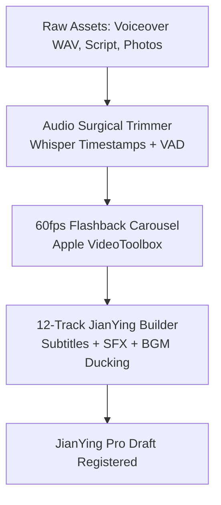

# 🏀 NBA Animation Effects (`nba-animation-effects`)

[](https://python.org)
[](#)
[](#)
[](#)
[](#)
[](LICENSE)

An automated, broadcast-grade **NBA sports broadcast animation effects** and player documentary video production suite for **Antigravity** and Python (1080P 60fps).

Transform raw player bios, statistics, milestones, voiceover audio, and photo assets into a **stunning visual documentary package** and a **production-ready 12-track JianYing Pro (剪映) project** matching the motion graphics standards of ESPN 30 for 30, NBA on TNT, and Netflix sports documentaries.

---

## ✨ Key Motion Graphics & Animation Modules

- **🌟 01 Hero Intro (10.0s)**:
  - Apple Vision machine-learning subject cutout with warm golden aura glow (`[255, 244, 152]`).
  - Massive banner `每天认识一位NBA球员` (182pt) placed **behind the player's head** with natural physical depth occlusion.
  - 5.0s heavy-impact player name slam on chest with sub-bass audio rumble.
- **🌀 02 Core Wordcloud Convergence (4.0s)**:
  - Integrates official NBA.com transparent headshot PNG (`1040x760`) centered in the foreground.
  - Pure black canvas with 3-tier dense keyword matrix (Tier 1 Pure White, Tier 2 Medium Grey, Tier 3 Dark Grey).
  - 0.5s rapid inward convergence towards the player's face, 0.46s sub-bass lock-in punch, and 3.5s sustained 6% micro-push.
- **🎬 03 Lower-Third Keyword Chapter Poster Cards (8.0s, 4 x 2.0s)**:
  - Chapter badge pill and mega title positioned strictly in the **lower third** (`y ~ 695px` and `y ~ 805px`), leaving player face and movement 100% unobstructed.
  - Multi-line split support for longer titles (e.g. `追梦格林` / `接班人`).
- **⚡ 04 & 06 Major Chapter Transitions (2.5s each)**:
  - High-impact drop-shadow chapter title slams (`基本信息` / `职业生涯经历及成就`).
- **📰 05 White Gradient Profile HUD (12.0s)**:
  - Clean magazine layout with left-to-right white gradient (`0.28..0.62`), team-color vertical indicator track, `#NO` watermark, and dual-stage bio & metrics presentation.
- **🏆 07 Career Era Honors Showcase**:
  - Calibrated timing: 0..1.5s displays era title & years only; 1.5s onward reveals honors sequentially at strict 1.5s intervals.
- **🎞️ 08 Career Milestone Cards Marquee (32.0s)**:
  - 20-card continuous slideshow powered by `IBM Plex Sans SC Bold` and the **1px Contour Shadow Policy** (1px outline stroke only on shadow layer, preventing black smudge blobs).
  - Procedural camera shutter SFX on each transition.
- **🎙️ Surgical Audio Breath Gap & Dead-Air Excision**:
  - Whisper word timestamps + RMS VAD: sub-clauses 0.05-0.08s, sentences 0.15-0.20s.
- **🎬 Automated 12-Track JianYing Pro Builder**:
  - One-click compile to native `draft_info.json` draft with voiceover, BGM ducking, SFX, subtitles, posters, and video tracks.

---

## 🚦 Production Pipelines

### Pipeline 1: Full 9-Module NLE Video Package

```mermaid
flowchart LR
    Intro["01: Intro 10s"] --> WC["02: Wordcloud 4s"]
    WC --> Posters["03: Lower-Third Posters 8s"]
    Posters --> Ch1["04: Major Ch1 2.5s"]
    Ch1 --> HUD["05: Profile HUD 12s"]
    HUD --> Ch2["06: Major Ch2 2.5s"]
    Ch2 --> Eras["07: Career Eras"]
    Eras --> Marquee["08: Marquee 32s"]
    Marquee --> Master["00: Full Master 1080P60"]
```



### Pipeline 2: 12-Track JianYing Pro Draft Project



---

## 💻 Quick Start

### Installation

```bash
git clone https://github.com/YoungG97/nba-animation-effects.git ~/.gemini/config/skills/nba-animation-effects
cd ~/.gemini/config/skills/nba-animation-effects
pip install opencv-python pillow numpy
```

### Python API

```python
from scripts.render_wordcloud import render_wordcloud_transition
from scripts.render_keyword_posters import render_keyword_posters

# Render 4.0s Core Wordcloud with NBA Official Transparent Headshot
render_wordcloud_transition(
    headshot_png="path/to/headshot.png",
    keywords=["11场高中篮球", "篮板痴汉", "全能怪兽", "追梦格林接班人", "草根逆袭神话"],
    out_mp4="02_wordcloud.mp4",
    out_jpg="02_wordcloud.jpg",
    team_key="GSW",
    duration=4.0
)
```

---

## 🛠️ Supported NBA Teams (30 Franchises)

Pre-configured official primary, secondary, and accent palettes in `scripts/team_colors.py`:
- `GSW`: Golden State Warriors (Royal Blue `(29, 66, 138)` & California Gold `(255, 199, 44)`)
- `OKC`: Oklahoma City Thunder (Thunder Blue `(0, 125, 195)` & Sunset Orange `(239, 59, 36)`)
- `DET`: Detroit Pistons (Royal Blue `(29, 66, 138)` & Crimson Red `(198, 12, 48)`)
- `LAL`: Los Angeles Lakers (Forum Purple `(85, 37, 130)` & California Gold `(253, 185, 39)`)
- `BOS`: Boston Celtics (Celtic Green `(0, 122, 51)` & Gold `(235, 186, 56)`)
- ... and all 25 other franchises.

---

## 📄 License

MIT License. See [LICENSE](LICENSE) for details.
