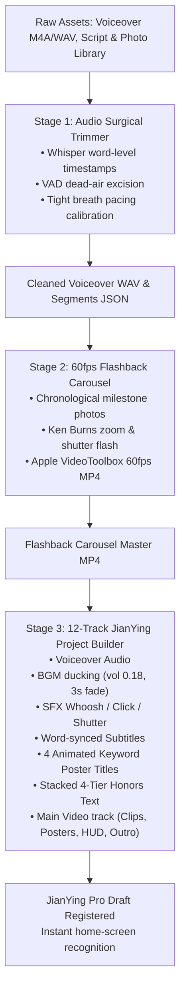

# NBA Player Video Maker (NBA 球星全自动电影级纪录片工坊)

This skill empowers Antigravity to transform any NBA player's textual biography, stats, awards, raw voiceover audio, and photos into a **broadcast-grade 1080P 60fps documentary video package** and a **ready-to-export 12-track JianYing Pro (剪映) project**, matching the visual and acoustic aesthetic of ESPN 30 for 30, NBA on TNT, and Netflix sports documentaries.

---

## 🎨 Core Design Standards

1. **Broadcast Typography Standard (严禁字体粘连)**:
   - **Primary Font**: `IBM Plex Sans SC Bold` (`~/Library/Fonts/IBMPlexSansSC-Bold.otf`) or `Hiragino Sans GB W6`.
   - Open counters (字怀开阔), geometric sans-serif structure, perfectly legible even in multi-stroke Chinese characters (如“星、冠、期、守、阵、第、队”).
   - Heavy impact font (`AlibabaPuHuiTi-2-115-Black.otf`) is reserved ONLY for mega titles (100pt+).
2. **The 1px Contour Shadow Policy (微距精修阴影)**:
   - **Zero Foreground Stroke**: Never add stroke expansion to the foreground text (`stroke_width = 0`).
   - **Subtle 1px Contour Shadow**: Apply a 1px outline stroke only on the shadow layer (`fill=(0, 0, 0, 220), offset=(1, 3)`). This creates a crisp 3D separation on bright/dark backgrounds without heavy black blobs or blur smudges.
3. **Surgical Breath Gap Calibration (字词级声学剪切与紧凑气口)**:
   - **Sub-clauses (逗号短从句)**: Strictly **0.05s ～ 0.08s**.
   - **Complete Sentences (句号/冒号)**: Strictly **0.15s ～ 0.20s**.
   - **Internal Dead-Air Excision**: Cut out any mid-sentence awkward silence > 0.15s, stutters, and false starts using Whisper word-level timestamps and RMS energy voice-activity-detection (VAD).
   - **Chapter Poster Window**: Strictly **1.000s** for the 4 keyword cards.
   - **Flashback Carousel**: Strictly **19.800s** (11 milestone photos * 1.800s) or **32.000s** (20 cards * 1.600s).
4. **Hardware-Accelerated 60fps Flashback Carousel**:
   - macOS Apple VideoToolbox (`h264_videotoolbox`) hardware encoding.
   - Ken Burns push-in zoom (1.000 to 1.035) + camera shutter flash brightness pop (t < 0.06s).
   - Bottom-left corner gradient scrim mask + 2-stage typography animation (Date + Details staggered ease-out slide with `#F5C518` golden accent).

---

## 🚦 Full Production 3-Stage Pipeline



---

## 📂 12-Track JianYing Pro Timeline Architecture

| Track # | Track Type | Track Name | Elements & Timing Behavior |
| :---: | :---: | :--- | :--- |
| **00** | Audio | `Voiceover_Audio` | Cleaned surgical voiceover audio (tight breath gaps, peak -2.0 dB). |
| **01** | Audio | `BGM_Music` | Dynamic sports BGM (`动感.mp3`), auto-ducked to volume `0.18`, 3s fade-out at end. |
| **02** | Audio | `SFX_Whoosh` | 4 high-impact whoosh/transition hits aligned to the start of each keyword poster card. |
| **03** | Audio | `SFX_Staircase_Click` | Mechanical feedback click sound effects triggering on each honors tier reveal. |
| **04** | Audio | `SFX_Flashback_Shutter` | Camera shutter sound effects triggering on every milestone photo in the flashback carousel. |
| **05** | Video | `Main_Video` | Sequential visual clips: Intro video -> Poster 1 Still -> Keyword 1 Video -> Poster 2 Still -> Keyword 2 Video -> Poster 3 Still -> Keyword 3 Video -> Poster 4 Still -> Keyword 4 Video -> Basic Info Profile -> Honors Backgrounds -> Flashback Carousel 60fps MP4 -> Outro Stills. |
| **06** | Text | `Subtitles` | Word-accurate synchronized subtitles generated from acoustic segment timestamps. |
| **07** | Text | `Keyword_Poster_Title` | 4 chapter poster title cards (size 12.0, bold, black border, upward slide animation). |
| **08** | Text | `Honor_Tier_1` | Tier 1 Honors Text (`1 次 NCAA 全国锦标赛总冠军 (2026)`, upward slide, y=0.22). |
| **09** | Text | `Honor_Tier_2` | Tier 2 Honors Text (`1 次 大十联盟 (Big Ten) 年度最佳球员 (2026)`, upward slide, y=0.08). |
| **10** | Text | `Honor_Tier_3` | Tier 3 Honors Text (`2 次 AAC 年度最佳防守球员 & 全美最佳防守阵容`, upward slide, y=-0.06). |
| **11** | Text | `Honor_Tier_4` | Tier 4 Honors Text (`1 次 AAC 锦标赛 MVP & 2次 NJCAA 全美一阵`, upward slide, y=-0.20). |

---

## 💻 Python API Usage

### 1. Audio Surgical Trimming & Breath Gap Calibration
```python
from scripts.audio_surgical_trimmer import slice_and_calibrate_audio

speech_items = [
    ([(0.73, 2.50), (2.70, 3.75)], "北京时间2026年10月27日，勇士大胜掘金，", 0.06),
    ([(7.20, 10.26)], "一位年仅24岁的新秀挺身而出接管了比赛：", 0.08),
    ([(11.49, 14.66)], "他仅出战31分钟便狂砍生涯新高的31分，", 0.06),
    # ...
]

total_dur, segments = slice_and_calibrate_audio(
    src_wav="raw_voiceover.wav",
    speech_items=speech_items,
    out_wav="cleaned_voiceover.wav",
    out_json="audio_segments.json",
    auto_energy_trim=True,
    fade_ms=4.0
)
```

### 2. 60fps Flashback Carousel Rendering
```python
from scripts.render_flashback_carousel import render_flashback_carousel

items = [
    ("path/to/01_college.jpg", "2023年11月10日，", "社区大学三年蛰伏蜕变初登NCAA，\n开启一级联盟逆袭征程"),
    ("path/to/02_mvp.jpg", "2024年3月17日，", "率队夺得AAC联盟冠军，\n全票荣获锦标赛MVP高举奖杯"),
    # ...
]

render_flashback_carousel(
    items=items,
    output_mp4="flashback_carousel_1080p.mp4",
    fps=60,
    dur_per_item=1.800
)
```

### 3. Full 12-Track JianYing Pro Draft Generation
```python
from scripts.jianying_project_builder import build_nba_jianying_project

draft_path = build_nba_jianying_project(
    project_name="雅克塞尔·伦德博格_人物志",
    voice_audio_path="cleaned_voiceover.wav",
    segments_path="audio_segments.json",
    bgm_music_path="music/dynamic_bgm.mp3",
    sfx_paths={
        "whoosh": "sfx/sfx_whoosh.wav",
        "click": "sfx/sfx_click.wav",
        "shutter": "sfx/sfx_shutter.wav"
    },
    poster_titles=posters,
    honors_tiers=honors,
    timeline_materials=timeline_materials,
    cover_image_path="cover.jpg"
)
```

---

## 🛠️ Supported NBA Teams & Color Presets
All 30 NBA teams are pre-configured in `scripts/team_colors.py`:
- `GSW`: Royal Blue `(29, 66, 138)` & Golden Yellow `(255, 199, 44)`
- `OKC`: Thunder Blue `(0, 125, 195)` & Sunset Orange `(239, 59, 36)`
- `DET`: Royal Blue `(29, 66, 138)` & Crimson Red `(198, 12, 48)`
- `LAL`: Forum Purple `(85, 37, 130)` & California Gold `(253, 185, 39)`
- `BOS`: Celtic Green `(0, 122, 51)` & Gold `(235, 186, 56)`
