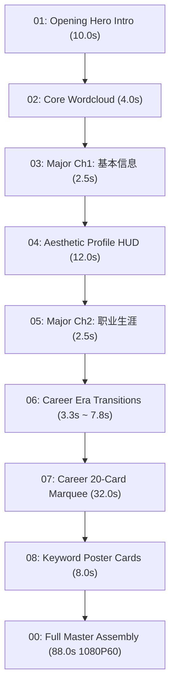

# NBA Player Video Maker (NBA 球星视频全自动生产工坊)

This skill empowers Antigravity to transform any NBA player's textual biography, stats, awards, and raw photos into a **broadcast-grade 1080P 60fps documentary video package** matching the visual aesthetic of ESPN, NBA on TNT, and Netflix sports documentaries.

---

## 🎨 Visual Philosophy & Design Standards

1. **Broadcast Typography Standard (严禁字体粘连)**:
   - **Primary Font**: `IBM Plex Sans SC Bold` (`~/Library/Fonts/IBMPlexSansSC-Bold.otf`).
   - Open counters (字怀开阔), geometric sans-serif structure, perfectly legible even in multi-stroke Chinese characters (如“星、冠、期、守、阵、第、队”).
   - Heavy impact font (`AlibabaPuHuiTi-2-115-Black.otf`) is reserved ONLY for mega titles (100pt+).
2. **The 1px Contour Shadow Policy (微距精修阴影)**:
   - **Zero Foreground Stroke**: Never add stroke expansion to the foreground text (`stroke_width = 0`).
   - **Subtle 1px Contour Shadow**: Apply a 1px outline stroke only on the shadow layer (`fill=(0, 0, 0, 220), offset=(1, 3)`). This creates a crisp 3D separation on bright/dark backgrounds without heavy black blobs or blur smudges.
3. **Calibrated Era Timing Rules (严格生涯时期时序)**:
   - **0.0s $\sim$ 1.5s (Exclusive Window)**: ONLY the era title and total time period (e.g., 《新秀及快速成长期 2022 - 2024》) are displayed alongside the dual-color team underline. NO honors are shown during this window!
   - **1.5s+ (Sequential Honors)**: Honors slide in sequentially at **1.5-second intervals** ("上一个出现结束，后面一个才出现").
4. **Procedural Sound Design (100% Free Local Synthesis)**:
   - All punch thuds, whooshes, camera shutters, and bass drops are synthesized locally in Python via NumPy/WAV—zero third-party audio dependencies.

---

## 🚦 Pipeline Architecture & Modules

A complete production run generates both individual timeline clips and a seamless master video:



### Module Breakdown

| Track | Module Name | Duration | Description |
| :---: | :--- | :---: | :--- |
| **01** | `01_开头人物入场_每天认识一位NBA球员_10秒.mp4` | **10.0s** | Full-width 182pt title 《每天认识一位NBA球员》 + 2.5D hero push + 5.0s name entrance slam with bass drop. |
| **02** | `02_核心词云过渡_4秒.mp4` | **4.0s** | 4–6 player tags converge inward to center in 0.5s + sustained forward push. |
| **03** | `03_大章节过渡一_基本信息_2.5秒.mp4` | **2.5s** | 2.5D hero push + bottom dark gradient + 180pt 《基本信息》 double drop shadow slam. |
| **04** | `04_详细基本信息杂志排版_12秒.mp4` | **12.0s** | Two-stage aesthetic HUD: Stage 1 (0..6s) Identity Bio; Stage 2 (6..12s) Physical Metrics & Positions with audio transition. |
| **05** | `05_大章节过渡二_职业生涯经历及成就_2.5秒.mp4` | **2.5s** | 150pt 《职业生涯经历及成就》 with heavy impact sound design. |
| **06** | `06_职业生涯时期过渡.mp4` | **3.3s / 7.8s** | 1.5s total time first + 1.5s sequential honors (Stack & Carousel modes). |
| **07** | `07_职业生涯全套连续跑马灯_32秒.mp4` | **32.0s** | 20 historical milestone cards (1.6s each) with camera shutter audio and subtle 1px contour shadow. |
| **08** | `08_关键词小章节全套合体连播_8秒.mp4` | **8.0s** | 4-chapter movie poster cards (Figure 2 aesthetic) with top badge pill, bold title, English subtitle, and bio. |
| **00** | `01_【全片合体】完整全片_1080P60.mp4` | **$\sim$88.0s** | Broadcast-normalized concatenation of all clips into a single master video. |

---

## 🛠️ Team Colors & Presets

All 30 NBA teams have pre-configured color schemes in `scripts/team_colors.py`:
- **Thunder (`OKC`)**: Thunder Blue `(0, 125, 195)` & Thunder Orange `(239, 59, 36)`
- **Pistons (`DET`)**: Royal Blue `(29, 66, 138)` & Crimson Red `(198, 12, 48)`
- **Lakers (`LAL`)**: Forum Purple `(85, 37, 130)` & California Gold `(253, 185, 39)`
- **Warriors (`GSW`)**: Royal Blue `(29, 66, 138)` & Golden Yellow `(255, 199, 44)`
- **Celtics (`BOS`)**: Celtic Green `(0, 122, 51)` & Gold `(235, 186, 56)`

---

## 💻 CLI & Usage

### 1. Run via Master Pipeline
```bash
python3 -m scripts.pipeline --config examples/jalen_williams.json
```

### 2. Standalone Era Transition
```python
from scripts.render_era_transitions import render_career_era

render_career_era(
    photo_path="assets/champion.jpg",
    title="迈入全明星与夺冠时期",
    years="2024 - 至今",
    honors=[
        ("NBA 总冠军", "X1"),
        ("NBA 全明星阵容", "X1"),
        ("NBA 最佳阵容第三队", "X1"),
        ("NBA 最佳防守阵容第二队", "X1"),
    ],
    out_mp4="output/era_02.mp4",
    team_key="OKC",
    mode="stack",
)
```

### 3. Output Packaging Structure
The pipeline automatically organizes files into direct-drop timeline folders:
- `00_【参考母片】全片无缝合体完整视频/`
- `04_职业生涯详细卡片/`
- `10_【直接拖入剪辑器】按时间线顺序单轨片段/` (01 to 09 sequential clips ready for Premiere, FCPX, or 剪映)
