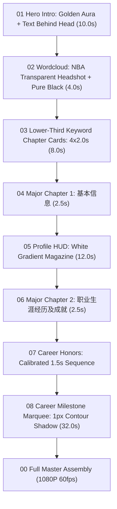
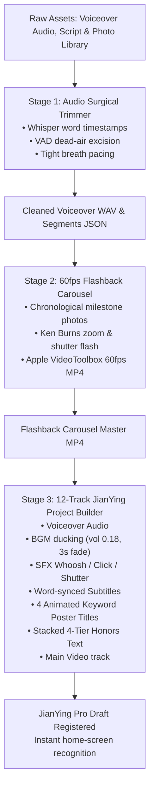

# NBA Animation Effects (NBA 动画效果)

This skill empowers Antigravity to transform any NBA player's textual biography, stats, awards, raw voiceover audio recordings, and photos into a **broadcast-grade 1080P 60fps documentary video package**, a **tightly calibrated voiceover timeline**, and a **ready-to-export 12-track JianYing Pro (剪映) project**, matching the visual and acoustic aesthetic of ESPN 30 for 30, NBA on TNT, and Netflix sports documentaries.

---

## 🎨 Core Visual & Acoustic Standards

1. **Module 01: Hero Intro (10.0s)**:
   - Arena background with Gaussian blur and top vignette.
   - Banner `每天认识一位NBA球员` (182pt) placed **BEHIND the player's head** with natural occlusion.
   - Apple Vision person segmentation with warm golden aura glow (`[255, 244, 152]`).
   - Chinese name slams at 5.0s on player chest with sub-bass impact sound effect.

2. **Module 02: Core Wordcloud Transition (4.0s)**:
   - Official NBA.com transparent headshot PNG (`1040x760`) centered in foreground.
   - Pure black background canvas.
   - 3-tier dense keyword matrix (Tier 1 Pure White, Tier 2 Medium Grey, Tier 3 Dark Grey) contracting inward towards the face over 0.5s.
   - Sub-bass lock-in punch at 0.46s, followed by sustained 6% inward micro-push over remaining 3.5s. Headshot remains on top layer.

3. **Module 03: Lower-Third Keyword Chapter Poster Cards (8.0s, 4 x 2.0s)**:
   - Chapter badge pill (`[CHAPTER 0X] PLAYER NAME · #NO`) at `y ~ 695px` and bold title at `y ~ 805px` in the **LOWER THIRD**.
   - Player's head, face, eyes, and action in the upper 60% remain completely unobstructed.
   - Multi-line split for long titles (e.g. `追梦格林` / `接班人`).

4. **Module 04 & 06: Major Chapter Transitions (2.5s each)**:
   - Module 04: 180pt `基本信息` slam with double drop shadow.
   - Module 06: 150pt `职业生涯经历及成就` slam with championship background push-in.

5. **Module 05: Detailed Basic Info White Gradient Magazine HUD (12.0s)**:
   - Left-to-right white gradient (`solid_ratio=0.28, fade_end_ratio=0.62`).
   - `#NO TEAM` watermark, `[PLAYER PROFILE · 球员档案]` pill badge, dual-color vertical indicator track.
   - Pure black text with 4px white stroke, team-color English name.
   - 2-stage presentation: 0..6s Identity & Bio; 6..12s Physical Metrics & Position.

6. **Module 07: Career Era Honors (Calibrated Timing)**:
   - First 1.5s: ONLY era title & years displayed.
   - 1.5s onward: sequential honors appear strictly at 1.5s intervals (one by one).

7. **Module 08: Career Milestone Cards Marquee (32.0s, 20 cards)**:
   - Primary Font: `IBM Plex Sans SC Bold` with open counters (字怀开阔).
   - The 1px Contour Shadow: clean foreground text (`stroke_width=0`), 1px outline stroke only on shadow layer (`offset=(1, 3)`), preventing black blur smudges.
   - Camera shutter audio SFX on every card transition.

8. **Surgical Breath Gap Calibration (字词级声学剪切与紧凑气口)**:
   - Sub-clauses (逗号短从句): Strictly **0.05s ～ 0.08s**.
   - Complete Sentences (句号/冒号): Strictly **0.15s ～ 0.20s**.
   - Internal dead-air excision via Whisper word timestamps + RMS VAD.

---

## 🚦 Full Production Pipelines

### Pipeline A: Complete 9-Module NLE Video Package



### Pipeline B: Automated 12-Track JianYing Pro (剪映) Project



---

## 📂 12-Track JianYing Pro Timeline Architecture

| Track # | Track Type | Track Name | Elements & Timing Behavior |
| :---: | :---: | :--- | :--- |
| **00** | Audio | `Voiceover_Audio` | Cleaned surgical voiceover audio (tight breath gaps, peak -2.0 dB). |
| **01** | Audio | `BGM_Music` | Dynamic sports BGM (`动感.mp3`), auto-ducked to volume `0.18`, 3s fade-out at end. |
| **02** | Audio | `SFX_Whoosh` | 4 high-impact whoosh/transition hits aligned to each keyword poster card. |
| **03** | Audio | `SFX_Staircase_Click` | Mechanical feedback click sound effects triggering on each honors tier reveal. |
| **04** | Audio | `SFX_Flashback_Shutter` | Camera shutter sound effects triggering on every milestone photo in the flashback carousel. |
| **05** | Video | `Main_Video` | Sequential visual clips: Intro video -> Poster 1 Still -> Keyword 1 Video -> Poster 2 Still -> Keyword 2 Video -> Poster 3 Still -> Keyword 3 Video -> Poster 4 Still -> Keyword 4 Video -> Basic Info Profile -> Honors Backgrounds -> Flashback Carousel 60fps MP4 -> Outro Stills. |
| **06** | Text | `Subtitles` | Word-accurate synchronized subtitles generated from acoustic segment timestamps. |
| **07** | Text | `Keyword_Poster_Title` | 4 chapter poster title cards (size 12.0, bold, black border, upward slide animation). |
| **08** | Text | `Honor_Tier_1` | Tier 1 Honors Text (`1 次 NCAA 全国锦标赛总冠军 (2026)`, upward slide, y=0.22). |
| **09** | Text | `Honor_Tier_2` | Tier 2 Honors Text (`1 次 大十联盟 (Big Ten) 年度最佳球员 (2026)`, upward slide, y=0.08). |
| **10** | Text | `Honor_Tier_3` | Tier 3 Honors Text (`2 次 AAC 年度最佳防守球员 & 全美最佳防守阵容`, upward slide, y=-0.06). |
| **11** | Text | `Honor_Tier_4` | Tier 4 Honors Text (`1 次 AAC 锦标赛 MVP & 2次 NJCAA 全美一阵`, upward slide, y=-0.20). |

---

## 💻 Python API Usage

### 1. Rendering Benchmark Motion Graphics
```python
from scripts.render_intro import render_hero_intro
from scripts.render_wordcloud import render_wordcloud_transition
from scripts.render_keyword_posters import render_keyword_posters
from scripts.render_profile_hud import render_profile_hud

# Module 02: Wordcloud with NBA Official Transparent Headshot
render_wordcloud_transition(
    headshot_png="headshots/player_headshot.png",
    keywords=["11场高中篮球", "篮板痴汉", "全能怪兽", "追梦格林接班人", "草根逆袭神话"],
    out_mp4="02_wordcloud.mp4",
    out_jpg="02_wordcloud.jpg",
    team_key="GSW",
    duration=4.0
)

# Module 03: Lower-Third Keyword Chapter Cards
render_keyword_posters(
    cards_data=[
        {"title": "11场高中篮球", "photo": "action1.jpg"},
        {"title": "篮板痴汉", "photo": "action2.jpg"},
        {"title": "全能怪兽", "photo": "action3.jpg"},
        {"title": "追梦格林接班人", "photo": "action4.jpg"},
    ],
    player_name="YAXEL LENDEBORG",
    jersey_num="#1",
    team_key="GSW",
    out_concat_mp4="03_keywords_concat.mp4"
)
```

### 2. Audio Surgical Trimming & Breath Gap Calibration
```python
from scripts.audio_surgical_trimmer import slice_and_calibrate_audio

total_dur, segments = slice_and_calibrate_audio(
    src_wav="raw_voiceover.wav",
    speech_items=speech_items,
    out_wav="cleaned_voiceover.wav",
    out_json="audio_segments.json",
    auto_energy_trim=True,
    fade_ms=4.0
)
```

### 3. Full 12-Track JianYing Pro Draft Generation
```python
from scripts.jianying_project_builder import build_nba_jianying_project

draft_path = build_nba_jianying_project(
    project_name="球员人物志",
    voice_audio_path="cleaned_voiceover.wav",
    segments_path="audio_segments.json",
    bgm_music_path="music/dynamic_bgm.mp3",
    sfx_paths={
        "whoosh": "sfx/sfx_whoosh.wav",
        "click": "sfx/sfx_click.wav",
        "shutter": "sfx/sfx_shutter.wav"
    },
    poster_titles=posters,
    honors_tiers=honors,
    timeline_materials=timeline_materials,
    cover_image_path="cover.jpg"
)
```

---

## 🛠️ Supported NBA Teams & Color Presets
All 30 NBA teams are pre-configured in `scripts/team_colors.py`:
- `GSW`: Royal Blue `(29, 66, 138)` & Golden Yellow `(255, 199, 44)`
- `OKC`: Thunder Blue `(0, 125, 195)` & Sunset Orange `(239, 59, 36)`
- `DET`: Royal Blue `(29, 66, 138)` & Crimson Red `(198, 12, 48)`
- `LAL`: Forum Purple `(85, 37, 130)` & California Gold `(253, 185, 39)`
- `BOS`: Celtic Green `(0, 122, 51)` & Gold `(235, 186, 56)`
